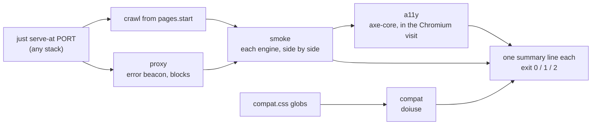

# web-dev-kit

**Tooling that lets an AI agent build a website fast, and prove it is accessible, compatible and quick.**

`wdk` is one command, `wdk check`, that an agent (or you) runs after every change. It starts your
site, crawls it, opens it in real browsers and prints a few lines: what broke, or a tick. Around it
sit starter templates for five stacks and a dev shell that installs everything, so a new project
works the minute you `cd` into it.

## What it gives you

- **Accessibility, guaranteed by a gate.** Every crawled page runs through axe-core (WCAG 2.2 AA plus best practice). A violation fails the check.
- **Compatibility, checked two ways.** Your CSS against a browserslist target (`compat`), and every page run in Chromium, Firefox and WebKit, even a pinned old Firefox (`smoke`): runtime errors, `console.error`, broken same-origin requests.
- **Performance you can trust.** `load` measures cold-cache LCP and image weight per viewport (phones as 3× on 4G, or Lighthouse's slow mobile); `perf` measures idle and mouse CPU per feature on macOS, with the measurement traps already fixed ([`docs/perf.md`](docs/perf.md)).
- **See it.** `shots` builds a contact sheet of pages × engine × viewport.
- **Five stacks, one contract.** `static`, `eleventy`, `vite`, `astro`, `kirby`. Each exposes one recipe, `just serve-at PORT`; every command works through it, so a new stack costs nothing.

## Why it is better than assembling it yourself

| | wdk | Hand-rolled (Lighthouse + Playwright + axe + scripts) |
|---|---|---|
| Agent cost | Short output: findings only, one summary line per check | Long reports the agent must read and filter |
| Speed | `check` runs compat, smoke and a11y on **one** server and **one** crawl; axe runs in smoke's own Chromium visit, engines side by side | Separate tools, each starting a server and crawling again |
| Setup | `nix flake init`, `direnv allow`, done; pinned versions, same on every machine and in CI | Per-project install and version drift |
| Downloads | Uses Chrome if installed; fetches only the browsers your config needs, once | Playwright pulls its own browsers per project |
| Errors | Exit 2 means setup is broken, and the message says the fix; `wdk doctor` lists every gap | Stack traces |
| Old browsers | Drive a pinned Firefox 115 (or any binary) through an injected error beacon | Unreachable or manual |
| Perf numbers | Whole-process-tree CPU, median of repeats, known traps guarded | One run, one process, wrong confidence |

Every command exits `0` pass, `1` findings, `2` broken setup, so it drops into CI or an agent loop unchanged.

## How `wdk check` works



One server, one crawl, one browser visit per page and engine. wdk never knows the stack: it only calls
`serve-at`, so adding a stack costs nothing.

## Start

```sh
nix run github:mstcgalis/web-dev-kit -- new static site  # or eleventy, vite, astro, kirby
cd site && direnv allow                                  # the dev shell loads on cd; wdk is on PATH
just check                                               # compat + smoke + a11y
```

`wdk new` copies the template, commits, creates a private GitHub repo and sets its CI secrets;
`--domain example.com --vps HOST` also makes a deploy key and opens the vps site entry as a PR; `--staging` adds `staging.example.com`.
Re-running it finishes whatever step failed. Offline or no GitHub: `--no-github`, or
`nix flake init -t github:mstcgalis/web-dev-kit#static`.

A template is a flake, a `justfile` (`serve-at`, `build`, `check`), a `wdk.config.js`, an `.envrc`, CI
workflows, an `AGENTS.md` of rules for the agent, and a starter page. Add
[nix-direnv](https://github.com/nix-community/nix-direnv) to make `cd` instant.

| Stack | Serves |
|---|---|
| `static` | `site/`, no build |
| `eleventy` | `src/` → `_site/` |
| `vite` | → `dist/` |
| `astro` | → `dist/` |
| `kirby` | Kirby from composer with `php -S`; checks render `tests/content` |

Existing project: add `wdk.lib.devShell { pkgs; stack = "…"; }` to its flake, a `serve-at` recipe and
a `wdk.config.js` ([how](docs/reference.md#use-in-an-existing-project)).

## Commands

Run `wdk` for the list; `--engines a,b` and `--skip REGEX` override the config.

| | |
|---|---|
| `wdk check` | `compat` + `smoke` + `a11y`, one server, one crawl. **Run after every change.** |
| `wdk a11y` | axe-core on every crawled page |
| `wdk compat` | `compat.css` against `compat.targets` (doiuse) |
| `wdk smoke` | every page × engine: errors, `console.error`, broken requests |
| `wdk load` | cold-load LCP, image weight, heaviest files; `--url` for a deployed site, `--slow`, `--cdn` |
| `wdk shots` | contact sheet at `.wdk/shots/…/index.html` |
| `wdk perf` | CPU per perf knob (macOS only) |
| `wdk new STACK DIR` | a project from a template, on GitHub with its secrets, optionally deployable |
| `wdk doctor` | what is missing, one line each, with the fix |
| `wdk install-browsers` | only the browsers your engines need (macOS) |
| `wdk deploy` | build and ship a release to the host in seconds; `rollback`, `list` ([how](docs/reference.md#deploys)) |
| `wdk update` | move the project to the latest wdk release (workflow pins, `flake.lock`) |
| `wdk serve-dir DIR PORT` | static server for a `serve-at` recipe |

## Configure

```js
// wdk.config.js
export default {
  pages: { start: ['/'], skip: '^/(media|panel)\\b', limit: 80 },
  engines: { ci: ['chromium', 'firefox', 'webkit'], local: ['chrome', 'firefox', 'webkit'] },
  viewports: [[390, 844], [1440, 900]],
  compat: { css: ['site/*.css'], targets: 'defaults', allow: [] },
};
```

All options, engines, the proxy and perf knobs: [`docs/reference.md`](docs/reference.md).

## More

- [`docs/reference.md`](docs/reference.md): config, engines, project wiring, deploys, updates, tokens
- [`docs/perf.md`](docs/perf.md): the ten measurement traps
- [`docs/roadmap.md`](docs/roadmap.md): what is not built yet (bootstrap CLI, content sync, DNS)
- [`AGENTS.md`](AGENTS.md): rules for contributors and agents, and how wdk is released

Develop: `nix develop`, `bun install`, `just check` before every commit. Licence: AGPL-3.0.
