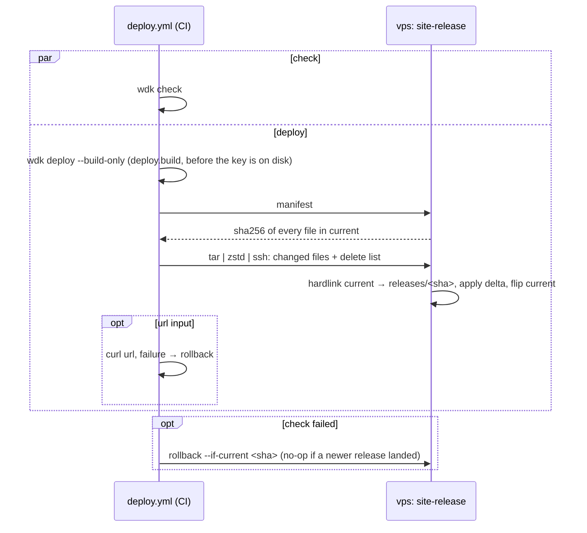

# Reference

## Use in an existing project

```nix
# flake.nix
{
  inputs.wdk.url = "github:mstcgalis/web-dev-kit"; # pinned by flake.lock; `wdk update` to upgrade
  inputs.nixpkgs.follows = "wdk/nixpkgs";
  outputs = { wdk, nixpkgs, ... }: {
    devShells = nixpkgs.lib.genAttrs [ "aarch64-darwin" "x86_64-linux" ] (system: {
      default = wdk.lib.devShell { pkgs = nixpkgs.legacyPackages.${system}; stack = "kirby"; }; # or "static"
    });
  };
}
```

The project's `justfile` must have **`serve-at PORT`**: a foreground server on PORT. Every command
starts the site through it. Static sites use `wdk serve-dir DIR {{PORT}}`.

## `wdk.config.js`

```js
export default {
  pages: { start: ['/', '/does-not-exist'], skip: '^/(media|panel)\\b', limit: 80 },
  engines: { ci: ['chromium', 'firefox', 'webkit'], local: ['chrome', 'firefox', 'webkit', 'exe:firefox:$WDK_FIREFOX_115'] },
  viewports: [[390, 844], [1440, 900]],
  compat: { css: ['assets/css/*.css'], targets: 'defaults, Firefox >= 115', allow: [] },
  proxy: { block: ['panel', 'api', '*.php'] },
  perf: { page: '/', knobs: { zoom: { css: '…', probe: '.slide img' }, seismo: { script: 'seismograph' } } },
  deploy: { host: 'SITE-deploy@HOST', dir: 'dist', build: 'just build' },
  content: { dir: 'content', targets: { production: 'root@HOST:/srv/sites/D/shared/content' } },
};
```

| Key | Meaning |
|---|---|
| `pages` | crawl entry points, a skip regex, a page limit |
| `engines` | `ci` and `local` lists: `chrome` (branded), `chromium`, `firefox`, `webkit`, or `exe:<firefox\|chrome>:<path>` for a binary Playwright cannot drive (path may be `$VAR`) |
| `viewports` | `[width, height]` pairs for shots and load |
| `compat` | stylesheet globs, browserslist `targets`, `allow` for accepted findings; no `css` = `check` skips compat |
| `proxy.block` | paths the proxy refuses |
| `perf` | the page to measure and the knobs (CSS or script variants) to compare; traps: [`perf.md`](perf.md) |
| `deploy` | `host` (restricted user), `dir` (what ships), `build` (run first) |
| `content` | `dir` (local copy), `targets` (name → `user@host:/path`) for `wdk content` |

## Browsers and the proxy

On Linux the dev shell provides browsers. On macOS, `wdk install-browsers` downloads only what the
configured engines need and is not already on disk; with Google Chrome installed, the default config
needs nothing (Chrome stands in for Playwright's Chromium). `wdk doctor` lists what is missing and
the fix.

Every browser goes through a proxy that injects an error beacon, which is how `exe:` engines report
errors. The proxy also takes `?wdk-off=a,b|static`, `?wdk-mouse` and `?wdk-freeze`, so
`wdk perf --serve` variants open on any device on the LAN.

## Exit codes

0 pass, 1 findings, 2 broken setup (the message says the fix). `doctor` exits 1 if anything is missing;
`compat` exits 2 if its globs match nothing; `shots`, `perf` and `load` exit 0.

## Deploys

A site is a directory on the vps; a release is one commit, flipped in atomically.

```
/srv/sites/<domain>/
├── current -> releases/<sha>     symlink, flipped atomically
├── releases/<sha>/ …             last 5 kept, read-only
└── shared/                       kirby only: content, media, accounts, sessions, cache, logs
```

Push to `main` runs the template's `deploy.yml`: `check` and `deploy` in parallel, so a hotfix never
waits on browsers.



Only changed files cross the wire (a full tar when there is no current release): seconds even for a
140 MB site, no CI on the vps.

| Where | What |
|---|---|
| `wdk.config.js` | `deploy: { host, dir, build }` |
| site repo secrets | `DEPLOY_SSH_KEY` (private key), `DEPLOY_HOST_KEY` (`ssh-keyscan -t ed25519 HOST` line, pinned), `NIX_ACCESS_TOKEN` if repos are private |
| vps | `services.sites.<name>.deployKey` = the public half (user `<slug>-deploy`, `restrict`, forced command `site-release`) |
| reusable `deploy.yml` | no `DEPLOY_SSH_KEY` secret: the job skips with a notice, so a new repo stays green |
| reusable `deploy.yml` inputs | `host` (another `user@host`, e.g. staging), `url` (curl after the flip; failure rolls back), `ref` (deploy that commit), `rollback` |

Staging and production: `staging` deploys with `host` set to the staging user; production can run on
`workflow_run` after the tests and pass `ref: github.event.workflow_run.head_sha`, so only the tested
commit ships.

`wdk new STACK DIR --domain D --vps HOST` does the site side: a fresh key into the repo secrets, the
host key (only if it matches `~/.ssh/known_hosts`: `ssh HOST` once first), `deploy.host` = `<domain with - for .>-deploy@HOST`, and the
`services.sites."D"` entry as a PR in the vps repo (`$WDK_VPS_REPO`, default `~/src/vps`; printed if there is none):
a new `nix/modules/<slug>.nix` imported by the production host, on `tls internal` (tunnel-only), no www for a
subdomain, plus its `tofu/dns` record (a tunnel CNAME, and www for an apex; the zone must already be on Cloudflare).
It is made in a temp worktree, so your vps checkout is untouched. Merge it and `just deploy-production`.
`--staging` adds `staging.D` (user `stg-<slug>-deploy`, no www, `X-Robots-Tag: noindex`) to the same PR, with
its own key in `STAGING_DEPLOY_SSH_KEY`, a `deploy-staging.yml` and a `staging` branch; re-run with it to add
staging to an existing project. The private keys exist only in the secrets.

Each run ends with every site's state: `live: URL`, or `not live yet` until the vps entry is switched in. The
first deploy fails before that (no deploy user yet); re-run `wdk new` after the switch and it re-runs the failed
deploy, seeing the vps seed page. `--wait` does that in one run: it polls each site (up to 30 min) until the
switch, then re-runs the deploy. Run bare at a terminal, `wdk new` asks for the stack, dir, domain and vps;
without a terminal (an agent) it prints the usage instead.

By hand: `wdk deploy` (`--no-build`, `--build-only`, `--host`), `wdk deploy rollback`, `wdk deploy list`.

**Kirby** (`kind = "kirby"`): mutable state lives in `shared/`, set by the PHP-FPM pool's
`KIRBY_SHARED`; releases are read-only code. The Kirby template ships all of it: `roots.php`
(reads `KIRBY_SHARED`), `just build` (`git archive` + `composer install --no-dev` into `.wdk/release`;
`.gitattributes` export-ignores the rest), a `css()`/`js()` content-hash `?v=` plugin, and the deploy
caller.

The Kirby license is state too: activated in the Panel, it lands in `shared/license`. Credentials (mail and
the like) are vps sops secrets: `secrets = [ "smtp_password" ];` in the site entry reads `<slug>: smtp_password`
from vps `secrets.yaml` (set it first; a missing key fails the switch), and PHP reads
`trim(file_get_contents(getenv('KIRBY_SECRETS') . '/smtp_password'))`.

## Content

A Kirby site's `content/` belongs to the server: the Panel writes it, git and releases never carry it.
`wdk content` moves it over rsync, merge-only: the newer file wins on either side and nothing is deleted.

| Command | Does |
|---|---|
| `wdk content pull T` | server into local `content/` (delete it first for an exact mirror) |
| `wdk content push T [PATH...]` | local into the server: the whole tree, or page paths relative to `content/` |
| `--dry` | prints what would move, changes nothing |

Pull first, then push only what you changed: `wdk content push staging artists/vesna --dry`. Each push first
takes a tar backup on the host (`~/.wdk-content-backups`, last 5 per target), then `chown`s the tree back to its
owner (the PHP-FPM pool) so the Panel can edit the pushed files. A push to `production` needs `--yes`. Targets use
root ssh (the deploy key only releases); `wdk new` fills them for Kirby.

## Updates and tokens

`wdk update` moves a project to the latest wdk release: workflow `@vX` pins, the flake tag, then
`nix flake update wdk`. Nothing is committed. Each template ships `update.yml`, which runs it weekly and
opens a PR.

One fine-grained GitHub PAT, `NIX_ACCESS_TOKEN`, covers everything. Locally:
`access-tokens = github.com=<token>` in `~/.config/nix/nix.conf`; in CI: a repo secret of that name
(the reusable workflows use it when set).

| Needed for | Permission |
|---|---|
| Nix fetching private site repos (and wdk, if private) | Contents read, all repositories (new repos need no step) |
| `update.yml` opening its PR | Contents, Pull requests and Workflows write on the project (the bump edits workflow files) |

## Project branches

`staging` deploys staging, `main` deploys production; both fast-forward only, conventional commits.
