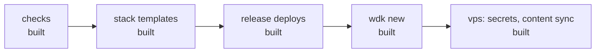

# Roadmap: what is not built yet

The end goal is one CLI that takes a website from first prompt to deployed (stack, repo, domain,
VPS, CI) in minutes, built from scripts rather than around any one agent. This file lists only what
is decided or known but **not built**; done work lives in git history and
[`superpowers/specs`](superpowers/specs).

## Stacks and conventions

- **Linters per stack** (Pint/PHPStan for Kirby, Prettier/ESLint for JS), probably pinned through
  the devShell. Undecided.
- **`docs/` contracts**: which of sonda's content, CSS and server contracts are generic.
- **Fast mode** (sonda's `AGENTS.md`) as a wdk convention or a per-project one.

## Checks: deferred

- **Static JS compat audit**: `smoke` in old engines covers real breakage. Add if a project ships
  JS to engines nobody can run.
- **Pixel diffs** against an approved baseline: only the contact sheet exists.
- **Old Safari**: unreachable on current macOS; needs an old-macOS VM or a device cloud.
- **Real old Chrome**: the `exe:chrome` path is tested; point `exe:chrome:<path>` at an old binary
  if a client needs it.
- **Perf on Linux and in CI**: `cpu.js` is macOS-only, and shared runners are noise.
- **LAN gallery** of every page × variant: `perf --serve` prints URLs instead.

## Known issues

- **`freePort()` race**: a `serve-at` that keeps running after a failed bind can still fool it. A
  nonce header would close it at the cost of every stack honouring it; left as is (2026-10-12).
- **`wdk perf` on Firefox/WebKit is noisy on a machine in use**: WebKit's synthetic pointer stops
  when its window loses focus. Run perf Chrome-only until there is an unattended machine or a
  focus-independent measurement.
